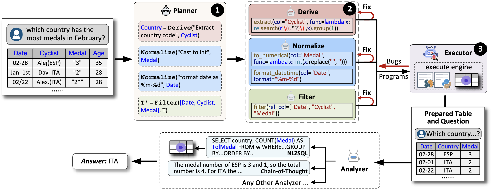
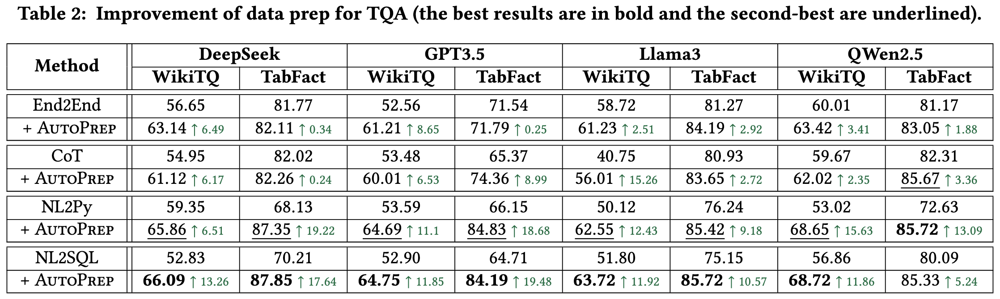
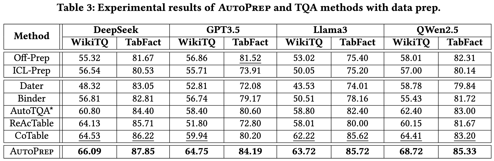

# Replicación de AutoPrep con Ollama

Comparación de NL2SQL y AutoPrep + NL2SQL con Qwen2.5-Coder 3B local.
Evaluación sobre 4.344 ejemplos de WikiTQ y 2.024 ejemplos de TabFact.

- [Procedimiento y resultados](REPLICACION.md)
- [Ajustes del entorno](ENTORNO_REPLICA.md)
- [Resultados en CSV](resultados/comparacion.csv)

---


# Multi-Agent Framework for Table Processing


Answering natural language (NL) questions about tables, known as Tabular Question Answering (TQA), is crucial because it allows users to quickly and efficiently extract meaningful insights from structured data, effectively bridging the gap between human language and machine-readable formats. Many of these tables are derived from web sources or real-world scenarios, which require meticulous data preparation (or data prep) to ensure accurate responses. However, preparing such tables for NL questions introduces new requirements that extend beyond traditional data preparation. This question-aware data preparation involves specific tasks such as column augmentation and filtering tailored to particular questions, as well as question-aware value normalization or conversion, highlighting the need for a more nuanced approach in this context. Because each of the above tasks is unique, a single model (or agent) may not perform effectively across all scenarios. In this paper, we propose AutoPrep, a large language model (LLM)-based multi-agent framework that leverages the strengths of multiple agents, each specialized in a certain type of data prep, ensuring more accurate and contextually relevant responses. Given an NL question over a table, AutoPrep performs data prep through three key components. Planner: Determines a logical plan, outlining a sequence of high-level operations. Programmer: Translates this logical plan into a physical plan by generating the corresponding low-level code. Executor: Executes the generated code to process the table. To support this multi-agent framework, we design a novel Chain-of-Clauses reasoning mechanism for high-level operation suggestion, and a tool-augmented method for low-level code generation. Extensive experiments on real-world TQA datasets demonstrate that AutoPrep can significantly improve the state-of-the-art TQA solutions through question-aware data preparation.



## Quick Start

### Environment Requirement

```bash
conda create -n ap python=3.9.15
conda activate ap
```

```bash
pip install -r requirements.txt
```

### Buildup Steps

1. Download the [datasets](https://pan.baidu.com/s/1osqtqDQVOBIQC4sjlnPFEA?pwd=tllm) with token <u>tllm</u> and unzip it to any path. And the constructed TransTQ dataset can be accessed by [TransTQ](https://pan.baidu.com/s/1jO_9Wn59XHtkK5uLyCdaSQ?pwd=tllm)  with token <u>tllm</u>.
2. Modify the `DATA_PATH` in [global_values.py](./src/global_values.py) to the root path of your downloaded datasets.
3. create a key file named `keys.txt` in the root and put your api keys in it (each key for one line)

## Overall Results



**Main Takeaway**: AutoPrep can improve the accuracy of all TQA baselines, especially for code generation baselines.



**Main Takeaway**: AutoPrep integrated with NL2SQL achieves SOTA performance on two TQA datasets based on four different LLM backbones.

## Contributing

:heavy_exclamation_mark: Please refer to [Developer Guides](https://matchbench.github.io/md_file/DeveloperGuides.html) when comitting.

## Citation

If you find our work helpful, please cite as:

```
@article{fan2024autoprep,
  title={AutoPrep: Natural Language Question-Aware Data Preparation with a Multi-Agent Framework},
  author={Fan, Meihao and Fan, Ju and Tang, Nan and Cao, Lei and Li, Guoliang and Du, Xiaoyong},
  journal={arXiv preprint arXiv:2412.10422},
  year={2024}
}
```